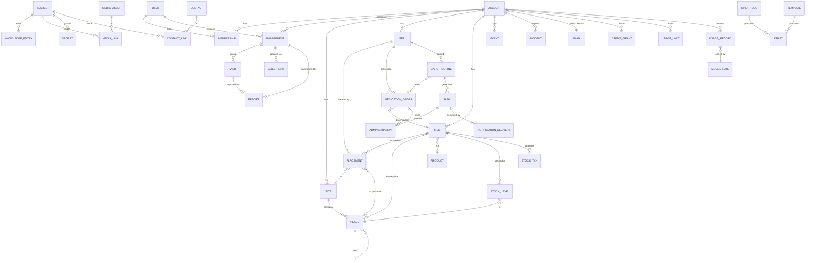

# 2. Domain model

This is the core's model. It has no AI, chat or UI concepts in it. Field types are logical (storage mapping is an adapter concern). `?` marks an optional field.

## 2.1 Conventions

Every entity has:

| Field | Type | Notes |
|---|---|---|
| `id` | UUIDv7 | Generated by the client or server; time-ordered; safe to create offline. |
| `account_id` | UUID | The tenant. Every query is scoped by it; no cross-account joins except through explicit sharing. |
| `created_at`, `updated_at` | instant (UTC) | |
| `created_by`, `updated_by` | actor ref | A user, the system, or an integration (see `Actor` below). |
| `version` | int | Optimistic concurrency and sync. Incremented on every write. |
| `deleted_at?` | instant | Soft delete; hard-deleted by a retention job or account deletion. |

Other conventions:
- **Instants** are UTC. **Local times** (for example `08:00` in a routine) are interpreted in a site's IANA `time_zone`.
- **Quantities** are `{amount: decimal, unit: string}` with units from a fixed list (`count`, `tablet`, `capsule`, `ml`, `g`, `kg`, `cup`, `can`, `click`, `roll`, `bag`…).
- **Durations** are ISO 8601 (`PT8H`).
- **Names** have `aliases: string[]` wherever people search by name ("ear medicine" for Methimazole, "the hedgehog" for a toy).

## 2.2 The subject registry

Knowledge, photos, contacts, events and permissions all need to point at "anything": a site, a place, a pet, an item or a medication order. Instead of loose polymorphic `(type, id)` pairs, each such entity registers once in a **subject** table that shares its id. Links then use real foreign keys.

| `Subject` | |
|---|---|
| `id` | Same UUID as the entity it registers |
| `account_id` | |
| `type` | `site` · `place` · `pet` · `item` · `medication_order` · `care_routine` · `contact` · `account` |

## 2.3 Overview

## 2.4 Identity, tenancy & access

**`User`**: a person who signs in. *Not account-scoped.*

| Field | Type | Notes |
|---|---|---|
| `display_name` | string | |
| `email`, `phone?` | string | Verified contact points. |
| `locale`, `time_zone` | string | For notifications and display; schedules use the site's zone, not the user's. |
| `auth_subject` | string | Opaque id from the identity port (OIDC, passkeys…). |

**`Account`**: the tenant.

| Field | Type | Notes |
|---|---|---|
| `name` | string | "Campbell household" |
| `kind` | enum | `household` · `pro_sitter` · `clinic` · `boarding` (only `household` in MVP) |
| `default_site_id?` | Site | |
| `plan_id`, `billing_anchor` | Plan, instant | The plan version, and when billing periods start (see 2.14). |
| `settings` | object | Feature flags, retention, and the capability routing table ([03 §3.9.3](03-core-architecture.md#393-routing-by-sensitivity)). |

**`Membership`**: `(user_id, account_id)` unique.

| Field | Type | Notes |
|---|---|---|
| `role` | enum | `owner` · `admin` · `family` · `caregiver` |
| `status` | enum | `invited` · `active` · `suspended` · `left` |
| `scope?` | object | Optional restriction to some sites/pets for standing caregivers (a regular dog walker). |

**`Invitation`**: email/phone or link token, intended role, optional engagement, `expires_at`, `accepted_at?`.

**`GuestLink`**: a sitter's way into one engagement without an account (Q11).

| Field | Type | Notes |
|---|---|---|
| `engagement_id` | Engagement | Access is exactly the engagement's: its pets, sites, permissions and window. |
| `token_hash` | bytes | The link carries a random token; only its hash is stored. |
| `recipient_name`, `recipient_phone?`, `recipient_email?` | | Where reminders and one-time codes go. |
| `verified_until?` | instant | Set when the guest enters a one-time code; required to reveal secrets ([04 §4.2](04-permissions-privacy.md#42-time-boxed-access)). |
| `last_opened_at?`, `revoked_at?` | instant | The owner sees when the link was last opened, and can revoke it at once. |

**`Engagement`**: a care job that grants time-boxed access.

| Field | Type | Notes |
|---|---|---|
| `caregiver_user_id?` | User | Null until an invitation is accepted. |
| `title` | string | "Halloween weekend" |
| `care_mode` | enum | `drop_in` · `overnight` · `boarding` (pets go to another site) · `live_in` |
| `starts_at`, `ends_at` | instant | |
| `access_lead`, `access_lag` | duration | Access opens before the start and closes after the end (defaults `P1D` / `PT12H`). |
| `pet_ids[]`, `site_ids[]` | refs | What the caregiver can see and act on. |
| `permissions` | set | Defaults from the caregiver role; e.g. `secrets.reveal` off unless granted. |
| `status` | enum | `draft` · `proposed` · `confirmed` · `active` · `completed` · `cancelled` |
| `notes?` | text | Owner-to-caregiver notes for this job. |
| `vet_authorization?` | object | `{may_authorize, spending_limit?, exclusions[], try_owner_first, notes?}`: whether the caregiver may approve treatment, up to what amount, never what (e.g. euthanasia). Shown on the emergency card during the engagement. |
| `returned_at?` | instant | Set by "I'm home": the engagement completes and household access closes immediately, without `access_lag`. |
| `summary_report_id?` | Report | The stay summary sent at handback (2.12). |

**`Visit`**: one planned visit inside a `drop_in` engagement (overnight stays can have one long visit).

| Field | Type | Notes |
|---|---|---|
| `engagement_id`, `site_id` | refs | |
| `planned_start`, `planned_end` | instant | |
| `checked_in_at?`, `checked_out_at?` | instant | Optional geofence check via the location port (V2). |
| `status` | enum | `planned` · `in_progress` · `completed` · `missed` · `cancelled` |
| `report_id?` | ref | The visit report sent to the owner. |

**`Actor`** (value object on every write and event): `{kind: user | guest | system | integration, user_id?, guest_link_id?, integration?: "assistant" | "mcp" | "discord" | ..., on_behalf_of_user_id?}`. When an AI assistant acts, the event says *assistant on behalf of Jane*. A sitter on a guest link appears in the shared log under the name the owner gave them.

## 2.5 Sites & places

**`Site`**: a real-world location.

| Field | Type | Notes |
|---|---|---|
| `name` | string | "Home", "Happy Paws Clinic", "Lake house" |
| `kind` | enum | `home` · `vacation_home` · `clinic` · `boarding` · `daycare` · `groomer` · `vehicle` · `park` · `other` |
| `ownership` | enum | `owned` (the account manages its places and items) · `external` (a reference: name, address, contacts only) |
| `address?` | structured | |
| `geo?` | lat/lng + radius | For check-in geofences. Sensitive. |
| `time_zone` | IANA string | **Required.** All routines at this site use it. |
| `aliases[]` | string[] | |
| `root_place_id` | Place | Every owned site has a root place; places hang off it. |

**`Place`**: a spot within a site, nested to any depth.

| Field | Type | Notes |
|---|---|---|
| `site_id` | Site | Denormalized for fast queries; must equal the parent's site. |
| `parent_id?` | Place | Null only for the root place. |
| `name` | string | "Pantry", "Shelf 2", "Blue airtight container" |
| `kind` | enum | `root` · `floor` · `room` · `zone` · `furniture` · `shelf` · `drawer` · `container` · `outdoor` · `other` |
| `path` | materialized path | E.g. `/home/kitchen/pantry/shelf-2/`; rebuilt on move; enables subtree queries ("everything in the kitchen"). |
| `description?` | text | "Second shelf from the top" |
| `backing_item_id?` | Item | Set for **portable containers** (carrier, go-bag): the place's real location is wherever that item is placed. V2. |
| `aliases[]`, `sort_order` | | |

## 2.6 Trackables: pets & items

Pets and items share location tracking, aliases and photos, so both specialize a **`Trackable`** (class-table inheritance: one `trackable` row plus one `pet` or `item` row with the same id).

**`Trackable`** (shared fields)

| Field | Type | Notes |
|---|---|---|
| `kind` | enum | `pet` · `item` |
| `name`, `aliases[]` | | |
| `current_site_id?`, `current_place_id?` | refs | **Denormalized** from the latest open `Placement`, for fast "where is X". |
| `current_placement_id?` | Placement | |
| `profile_media_id?` | MediaAsset | |

**`Pet`**

| Field | Type | Notes |
|---|---|---|
| `species` | enum + text | `cat`, `dog`, `rabbit`, `bird`, `fish`, `reptile`, `other` + free text |
| `breed?`, `sex?`, `neutered?`, `birth_date?` (or estimated) | | |
| `color_markings?`, `microchip_id?` | | Microchip is private-sensitivity. |
| `status` | enum | `active` · `deceased` · `rehomed` |
| `home_site_id` | Site | Where the pet normally lives. |

**`Item`**

| Field | Type | Notes |
|---|---|---|
| `category_id` | Category | Tree: Toys, Food, Medication, Supplies › Cleaning, Equipment, Documents… |
| `product_id?` | Product | Brand/barcode identity (V2). |
| `tracking` | enum | `unique` (one physical thing: the hedgehog toy, the carrier) · `consumable` (a supply measured in stock: poop bags, wipes, cat food) |
| `home_place_id?` | Place | **Where it belongs.** Distinct from where it currently is. |
| `pet_ids[]` | refs | Whose it is, if anyone's (Biscuit's leash). |
| `default_unit?` | unit | For consumables. |
| `expires_on?` | date | V2. |
| `sensitivity` | enum | `normal` · `private` (e.g. prescription bottles: labels show name and address) |

**`Placement`**: where a trackable is or was. Append-mostly history.

| Field | Type | Notes |
|---|---|---|
| `trackable_id` | Trackable | |
| `site_id` | Site | Required: we always know at least the site. |
| `place_id?` | Place | Must belong to `site_id`. |
| `with_user_id?` | User | "With the sitter on a walk", "in Jane's car". |
| `kind` | enum | `moved` (someone deliberately moved it) · `seen` (observed there) · `inferred` (e.g. from a boarding engagement) · `returned_home` |
| `observed_at` | instant | |
| `ended_at?` | instant | Set when superseded. **Exactly one open placement per trackable.** |
| `note?`, `media_id?` | | "Under the couch" + photo |

Why both `home_place_id` and `Placement`: people ask both "where does it go?" and "where is it?". The answer to "where is the leash?" is the last placement if recent, otherwise the home place: "it lives in the front-door basket; last seen there yesterday".

**`Category`**: account-specific tree seeded from a global template. `name`, `parent_id?`, `icon?`.

**`Product`** (V2): global or account-scoped catalog. `name`, `brand?`, `barcode?`, `category_id`, `default_unit`, `package_size?`, `media_id?`, `is_medication`, `drug?` (active ingredient, strength, form).

## 2.7 Inventory

**`StockLevel`**: how much of a consumable is at a place. Unique on `(item_id, place_id)`.

| Field | Type | Notes |
|---|---|---|
| `item_id` | Item (`tracking = consumable`) | |
| `place_id` | Place | |
| `level` | enum | `plenty` · `low` · `out`. Set directly by anyone in scope, or derived from `quantity` and `low_threshold` for counted supplies. |
| `quantity?` | Quantity | Current amount, only for supplies the household chooses to count. |
| `low_threshold?`, `target_level?` | Quantity | For counted supplies: alert when quantity ≤ threshold; the shopping list fills up to the target. |
| `counted_at?` | instant | Last physical count. |

**`StockTransaction`**: every change, immutable.

| Field | Type | Notes |
|---|---|---|
| `item_id`, `place_id` | refs | |
| `delta` | Quantity | Negative for use. |
| `reason` | enum | `restock` · `consumed` · `count_adjustment` · `transfer_in` · `transfer_out` · `expired` · `lost` |
| `task_id?`, `administration_id?` | refs | Auto-consumption from feeding tasks or doses (V2). |
| `occurred_at` | instant | |

For counted supplies, `StockLevel.quantity` always equals the sum of its transactions (kept in the same write). Uncounted supplies have no transactions; each level change is an event (`stock.level_changed`).

**`ShoppingListEntry`**: `item_id`, `quantity?`, `source` (`low_stock` | `manual`), `status` (`open` | `bought` | `dismissed`). A supply turning `low` or `out` opens a `low_stock` entry.

## 2.8 Medications

Safety-critical, so fully structured. The owner's own words are kept alongside the structure, never replaced by it.

**`MedicationOrder`**: a subject.

| Field | Type | Notes |
|---|---|---|
| `pet_id` | Pet | |
| `drug_name` | string | "Ondansetron" (+ `aliases[]`: "anti-nausea", "Zofran") |
| `product_id?` | Product | E.g. Maropitant citrate 24 mg = Cerenia. |
| `strength?` | string | "4 mg", "5 mg/0.1 ml" |
| `form` | enum | `tablet` · `capsule` · `liquid` · `transdermal_pen` · `injection` · `topical` · `powder` · `other` |
| `dose` | Quantity | `0.5 tablet`, `2 click` |
| `route` | enum | `oral` · `ear_skin` (transdermal) · `topical` · `injection` · `eye` · `other` |
| `administration_method?` | text | "Spread in the ear flap"; "mix half capsule powder into food" |
| `schedule_kind` | enum | `scheduled` · `as_needed` (PRN) |
| `min_interval?` | duration | `PT8H`. Enforced for both kinds. |
| `max_doses_per_window?` | `{count, window}` | E.g. 1 per `PT24H`. |
| `not_before?` | instant | One-off lockout ("not until Tue 08:00"), stored as an exact instant. |
| `prn_indication?` | text | When to give an as-needed dose ("if he won't take his meds"; "if vomiting"). |
| `starts_on`, `ends_on?` | date | |
| `instructions_verbatim` | text | **Exactly as the owner or label wrote it.** Shown next to any computed answer. |
| `if_missed?` | text | What to do when a dose is late or missed, in the owner's words ("Don't double up. Call the vet if two doses are missed."). Shown with every overdue reminder. |
| `if_refused?` | text | What to do when the pet refuses or spits out a dose. |
| `alert_owner_on` | set | Outcomes that alert the owner at once. Default: `refused`, `spat_out`, `vomited_after`, `skipped`, and a dose turning `missed`. |
| `item_id?` | Item | The physical bottle/pen and therefore where it's kept. |
| `prescriber_contact_id?` | Contact | |
| `status` | enum | `active` · `paused` · `completed` · `discontinued` |

Changes to dose, interval or limits create a new **`MedicationOrderRevision`** (`order_id`, snapshot, `effective_from`, `changed_by`, `changed_at`, `reason`). A revision can take effect in the future, so a taper ("½ tablet from Monday, ¼ from the 20th") is a series of dated revisions. Administrations reference the revision in force at the time of the dose, and `can_administer` uses it.

**`Administration`**

| Field | Type | Notes |
|---|---|---|
| `order_id`, `order_revision_id` | refs | |
| `task_id?` | Task | Null for as-needed doses. |
| `status` | enum | `given` · `partial` · `refused` · `spat_out` · `vomited_after` · `skipped` · `not_needed` |
| `dose_given?` | Quantity | Defaults to the ordered dose. |
| `administered_at` | instant | When it actually happened (may be back-dated, with `recorded_at` kept separately). |
| `recorded_at`, `recorded_by` | | |
| `note?`, `media_id?` | | |

**Derived, never stored by an LLM**: `can_administer(order, at)` returns `{allowed, reason, next_allowed_at, last_given_at, doses_in_window}` from the order revision, `not_before`, `min_interval`, `max_doses_per_window` and the administrations. Statuses `vomited_after` and `spat_out` still count as given for safety limits unless the order says otherwise.

## 2.9 Care routines & tasks

**`CareRoutine`**: a subject.

| Field | Type | Notes |
|---|---|---|
| `title` | string | "Breakfast", "Methimazole", "Scoop litter box" |
| `kind` | enum | `feeding` · `medication` · `walk` · `litter` · `grooming` · `play` · `cleaning` · `check` · `custom` |
| `pet_ids[]` | refs | Empty for household chores. |
| `site_id?` | Site | Applies only at this site; null = wherever the pet currently is (its time zone follows the pet). |
| `medication_order_id?` | MedicationOrder | Required when `kind = medication`; dose comes from the order. |
| `recurrence` | union | See below. |
| `window_before`, `window_after` | duration | The on-time window around each due time (e.g. `PT30M` / `PT1H`). |
| `grace_after` | duration | After this, an incomplete task becomes `missed`. |
| `instructions?` | text | "½ can wet food in his blue bowl" |
| `consumes?` | `[{item_id, quantity}]` | Auto stock decrement on completion (V2). |
| `requires_evidence` | enum | `none` · `note` · `photo` |
| `reminder_policy` | object | `{remind_before, repeat_every, escalate_after, escalate_to[]}`. Defaults by kind: medications remind at the due time, repeat every 10 minutes until answered, and escalate to the owner after 30 minutes, then to a backup contact. Feeding reminds once. See 2.15. |
| `active_from?`, `active_until?` | instant | |
| `engagement_id?` | Engagement | Routine only during this job (e.g. boarding instructions). |
| `status` | enum | `active` · `paused` · `archived` |

`recurrence` is one of:
- **Calendar**: `{type: "calendar", rrule: "FREQ=DAILY", times: ["08:00","20:00"]}`, interpreted in the site's time zone. Daylight-saving transitions follow RFC 5545 rules.
- **Interval**: `{type: "interval", every: "PT8H", anchor: "last_completion" | "start", first_due?: instant}`. Next due = last completion + interval. Needed for "every 8 hours" medications.
- **One-off**: `{type: "once", due_at: instant}`.

**`Task`**: one occurrence. Unique on `(routine_id, due_at)` so generation is idempotent.

| Field | Type | Notes |
|---|---|---|
| `routine_id` | CareRoutine | |
| `due_at` | instant | |
| `window_start`, `window_end` | instant | From the routine's windows. |
| `status` | enum | `upcoming` · `due` · `done` · `late` (done after the window) · `skipped` · `missed` · `cancelled` |
| `completed_at?`, `completed_by?` | | |
| `skip_reason?`, `note?` | text | |
| `evidence_media_ids[]` | refs | |
| `visit_id?` | Visit | Which visit it was done in. |
| `administration_id?` | Administration | For medication tasks. |

Calendar tasks are **materialized ahead** for a rolling horizon (e.g. 14 days) by a scheduler job and on routine change. Interval tasks are materialized one at a time: the next is created when the previous one completes. `upcoming` / `due` / `missed` are derived from the clock, and the stored status is only updated by the job for notifications, so reads are always correct even if the job is late.

**Derived queries**: `today(site or pet, at)`, `whats_next(scope, at)`, `overdue(scope, at)`, `last_done(routine)`. Each returns structured rows; an AI may phrase them.

## 2.10 Knowledge, secrets & contacts

**`KnowledgeEntry`**

| Field | Type | Notes |
|---|---|---|
| `subject_id` | Subject | What it's about: a pet, item, place, site, medication order, or the account. |
| `kind` | enum | `instruction` · `note` · `behavior` · `baseline` (what's normal for this pet: hairballs, limping after naps) · `preference` (favorite toy/spot) · `rule` (house rule) · `playbook` (emergency steps, with "watch and wait" vs. "call the vet now" thresholds) |
| `title` | string | "If Sonic vomits" |
| `body` | markdown | |
| `steps?` | `[{order, text, contact_id?}]` | For playbooks. |
| `related_subject_ids[]` | refs | "Favorite spot" links the pet *and* the place. |
| `tags[]` | | |
| `sensitivity` | enum | `normal` · `private` (owners/family only). Secrets are a separate entity. |
| `priority` | enum | `critical` (always shown, e.g. "never let him out the back door") · `normal` |
| `valid_from?`, `valid_until?` | instant | Temporary notes ("fridge is broken this week"). |
| `current_revision_id` | KnowledgeRevision | |

**`KnowledgeRevision`**: immutable `{entry_id, title, body, steps, edited_by, edited_at}`.

**`Secret`**

| Field | Type | Notes |
|---|---|---|
| `subject_id` | Subject | Usually a site ("Alarm code") or the account ("Wi-Fi"). |
| `label` | string | Not secret. |
| `ciphertext`, `key_id` | bytes | Envelope-encrypted via the crypto port; the plaintext never sits in the main database. `key_id` names where the key lives (cloud KMS or the owner's edge node, [03 §3.9.4](03-core-architecture.md#394-trade-off-parts-at-home-can-go-offline)). |
| `reveal_policy` | enum | `members` · `engaged_caregivers` · `owners_only` |
| `assistant_access` | enum | `never` (default) · `on_request`: whether AI adapters may ever receive it. |

**`SecretReveal`**: `{secret_id, revealed_to, actor, at, interface}`. Every reveal is logged, and the owner can see the log.

**`Contact`**: `name`, `organization?`, `kind` (`vet` · `emergency_vet` · `owner` · `family` · `neighbor` · `groomer` · `walker` · `sitter` · `pharmacy` · `other`), `phones[]`, `email?`, `address?`, `hours?`, `notes?`, `user_id?` (if they're also a user).

**`ContactLink`**: `{contact_id, subject_id, role}`, e.g. `(Happy Paws, Sonic, primary_vet)` and `(City Animal ER, Home site, emergency_vet)`.

## 2.11 Media

**`MediaAsset`**

| Field | Type | Notes |
|---|---|---|
| `storage_key` | string | Opaque key in the blob-store port. |
| `mime_type`, `bytes`, `sha256` | | Dedup by hash. |
| `width?`, `height?`, `duration?` | | |
| `metadata_stripped` | bool | **Must be true** before the asset is linked; EXIF/GPS removed on ingest. |
| `sensitivity` | enum | `normal` · `private` (e.g. prescription labels) |
| `variants` | object | Thumbnails and resized versions. |

**`MediaLink`**: `{media_id, subject_id, role, caption?, sort_order}` where `role` is `profile` · `reference` (what it looks like / where it is) · `label` · `evidence` · `document`.

## 2.12 Incidents & events

**`Incident`**

| Field | Type | Notes |
|---|---|---|
| `pet_ids[]`, `site_id?` | refs | |
| `type` | enum | `vomiting` · `diarrhea` · `not_eating` · `injury` · `escaped` · `behavior` · `property` · `other` |
| `severity` | enum | `info` · `concern` · `urgent` · `emergency` |
| `occurred_at`, `description`, `media_ids[]` | | |
| `status` | enum | `open` · `acknowledged` · `resolved` |
| `playbook_entry_id?` | KnowledgeEntry | The playbook that was followed. |

Severity `urgent` or higher notifies owners immediately through every enabled channel.

**`Event`**: the append-only activity log.

| Field | Type | Notes |
|---|---|---|
| `type` | string | `task.completed`, `medication.administered`, `trackable.moved`, `stock.adjusted`, `stock.low`, `incident.reported`, `secret.revealed`, `engagement.started`, … |
| `occurred_at`, `recorded_at` | instant | |
| `actor` | Actor | Including the interface it came through. |
| `subject_ids[]` | refs | For per-pet / per-site feeds. |
| `engagement_id?`, `visit_id?` | refs | For visit reports. |
| `payload` | object | Versioned schema per type. |
| `correlation_id?` | UUID | Ties together events from one command. |

**`Report`**: an update sent to the owner, built from events.

| Field | Type | Notes |
|---|---|---|
| `kind` | enum | `visit` · `daily` · `stay` (the summary at handback) |
| `engagement_id?`, `visit_id?` | refs | |
| `range` | `{from, to}` instants | |
| `sections` | object | Tasks on time, late and missed; doses and their outcomes; incidents; supply changes. Always present. |
| `media_ids[]` | refs | Photos taken in the range. |
| `prose?` | text | Optional summary from the `LanguageModel` port. The structured sections never depend on it. |
| `sent_at?` | instant | |

## 2.13 Health records (V2)

`WeightRecord` (`pet_id`, `weight`, `measured_at`), `Condition` (`name`, `diagnosed_on`, `status`, notes), `Vaccination` (`vaccine`, `given_on`, `due_on`, `clinic_contact_id`), `VetVisit` (`site_id`, `date`, `reason`, `summary`, documents via `MediaLink role=document`).

In MVP, vaccination certificates and vet documents attach to the pet as `MediaLink role=document`, so boarding and daycare can be shown proof before structured records exist.

## 2.14 AI usage & allotments

Hosted model calls and SMS messages are metered per account (see [03 §3.10](03-core-architecture.md#310-ai-usage-metering)). Usage records hold counts and costs, never prompt, reply or message text.

**`Plan`**: *not account-scoped; versioned.* `code`, `name`, `period` (e.g. `P1M`), `credits_per_period`, `default_limits[]` (`UsageLimit` templates), `features` (flags). Accounts point at a plan version, so editing a plan never silently changes existing accounts.

**`ModelRate`**: *not account-scoped.* A new row for every price change, so past usage keeps the rate it was charged at.

| Field | Type | Notes |
|---|---|---|
| `provider`, `model` | string | E.g. `hosted:claude` and the model id |
| `effective_from` | instant | |
| `cost_per_mtok` | `{input, output, cache_write, cache_read}` money | What the provider charges us per million tokens |
| `credits_per_mtok` | `{input, output, cache_write, cache_read}` decimal | What the customer is charged. Proportional to cost = cost-based credits; equal across models = token-based; anything between is a blend. |
| `cost_per_image?`, `credits_per_image?` | | For vision calls |

**`UsageRecord`**: the immutable ledger, one row per model call.

| Field | Type | Notes |
|---|---|---|
| `occurred_at` | instant | |
| `actor`, `interface` | | Who caused it and through which interface (`system` for automatic visit reports) |
| `capability` | enum | `language_model` · `vision` · `sms` (later `embedding`, `speech`) |
| `purpose` | enum | `assistant` · `care_note_import` · `visit_report` · `photo_lookup` · `summary` · `sitter_reminder` · … |
| `provider`, `model`, `rate_id` | | The rate in force at the time |
| `tokens` | `{input, output, cache_write, cache_read}` int | As reported by the provider |
| `images` | int | |
| `provider_cost` | money | Exact decimal in micro-units of the currency |
| `credits` | decimal | |
| `billable` | bool | False for the owner's edge node or an owner-supplied provider key |
| `outcome` | enum | `ok` · `error` · `cancelled` (failed calls can still use tokens) |
| `reservation_id`, `correlation_id`, `engagement_id?` | refs | `correlation_id` groups the calls of one assistant turn |

**`CreditGrant`**: credits added to an account.

| Field | Type | Notes |
|---|---|---|
| `amount`, `remaining` | decimal | |
| `source` | enum | `plan_period` · `top_up` (V2) · `promo` · `adjustment` |
| `valid_from`, `expires_at?` | instant | The plan's grant expires at the end of its period; top-ups may last longer |

The **credit balance** is the sum of unexpired grants' `remaining`. Usage draws from the soonest-expiring grant first.

**`UsageLimit`**: an extra cap, checked with the balance before every billable call.

| Field | Type | Notes |
|---|---|---|
| `metric` | enum | `credits` · `tokens` · `cost` · `requests` |
| `window` | enum + duration | `billing_period` · `rolling` (`P1D`, `PT1H`, `PT1M`) · `turn` (one assistant turn) |
| `amount` | decimal | |
| `scope` | object | `account` · `member` (user) · `engagement` · `purpose` · `integration` |
| `on_exceed` | enum | `block` · `degrade` (try the next provider) · `allow_overage` (later) |
| `warn_at[]` | percent | Default `[80, 100]` |
| `source` | enum | `plan` · `owner` (may only tighten the plan's limits) · `admin` |

**`UsageReservation`**: the estimated maximum use of one call, held until it settles: `estimate` (`{credits, tokens, cost, requests}`), `limit_ids[]`, `expires_at`, `status` (`held` · `settled` · `released` · `expired`).

**`UsageCounter`**: derived and rebuildable from the ledger, like `StockLevel` from stock transactions: `(limit_id, window_start)` → `used`, `reserved`.

## 2.15 Notifications & reminders

Reminders that fire reliably are the most valued feature in the category ([06 #1](06-feature-research.md#63-ranked-features)), so every message is tracked from sent to answered.

**`NotificationPreference`**: per user (or guest link) per account.

| Field | Type | Notes |
|---|---|---|
| `channels` | set | `push` · `email` · `sms` · `web_push`, in order of preference |
| `quiet_hours?` | `{from, to}` local times | |
| `medication_overrides_quiet_hours` | bool | Default true. |
| `discreet` | bool | Keep medication names and health details off lock screens and out of SMS text; show the routine's title instead. |

**`NotificationDelivery`**: one row per message.

| Field | Type | Notes |
|---|---|---|
| `recipient` | User or GuestLink | Guest sitters have no app: medication reminders go by SMS, the rest by email or web push. |
| `channel` | enum | `push` · `email` · `sms` · `web_push` |
| `kind` | enum | `reminder` · `escalation` · `dose_alert` · `incident` · `update` · `report` · `readiness` |
| `task_id?`, `subject_ids[]` | refs | |
| `sent_at`, `delivered_at?`, `opened_at?`, `answered_at?` | instant | Receipts where the channel provides them. |
| `superseded_at?` | instant | Set when someone completes the task: the reminder is withdrawn on every device. |
| `status` | enum | `queued` · `sent` · `delivered` · `failed` · `answered` · `superseded` |

Delivery rates per channel feed the `DeliveryMonitor` job ([03 §3.6](03-core-architecture.md#36-background-jobs-jobscheduler-port)). When a channel fails for a recipient, the next one in their list is tried.

## 2.16 Setup: templates & import drafts

Setup must take minutes, not an evening ([06 #6](06-feature-research.md#63-ranked-features)). Templates and AI import both produce **drafts**; nothing becomes a record until a person accepts it.

**`Template`**: *not account-scoped.* A starter set such as `cat`, `dog`, `puppy` or `senior_on_medication`: routines, knowledge prompts ("What's normal for her?"), playbooks and place suggestions.

**`ImportJob`**: an owner's pasted care note being turned into drafts. `source_text` (private; kept until the job is done, then deleted unless the owner keeps it), `masked_secrets` (likely codes and passwords found locally before any model sees the text), `status` (`drafting` · `ready` · `done` · `failed`), `usage_record_ids[]`.

**`Draft`**: a proposed record waiting for a person.

| Field | Type | Notes |
|---|---|---|
| `import_job_id?`, `template_id?` | refs | Where it came from. |
| `target_type` | enum | `care_routine` · `medication_order` · `contact` · `place` · `item` · `knowledge_entry` · `secret` |
| `proposed` | object | Field values, validated against the target's schema. |
| `source_excerpt?` | text | The sentences it came from. For a medication order this becomes `instructions_verbatim`. |
| `status` | enum | `pending` · `accepted` · `edited_and_accepted` · `rejected` |
| `decided_by?`, `decided_at?` | | |

## 2.17 Invariants (enforced by the core)

1. A `Place` belongs to exactly one `Site`, the same as its parent; there are no cycles.
2. A trackable has **at most one open** `Placement`, and its `place_id` belongs to its `site_id`. `Trackable.current_*` always mirror it.
3. Items with `tracking = consumable` have stock and no placement; `unique` items have placement and no stock.
4. For counted supplies, `StockLevel.quantity = Σ StockTransaction.delta` for that item and place, and is never negative without an explicit `count_adjustment`.
5. `CareRoutine.kind = medication` ⇔ `medication_order_id` is set; the order's pet is in `pet_ids`.
6. An `Administration` that breaks `can_administer` is **refused** unless recorded with an explicit override reason by an owner (e.g. a vet's instruction), which raises an event.
7. Every entity's `account_id` equals the `account_id` of everything it references.
8. Any linked `MediaAsset` has `metadata_stripped = true`.
9. A caregiver's access is valid only within `[engagement.starts_at − access_lead, engagement.ends_at + access_lag]`, ends at `returned_at` if the owner is home early, and covers only the engagement's pets and sites.
10. A billable model call or SMS starts only with a held `UsageReservation` that fits within the credit balance and every applicable `UsageLimit`.
11. Credit balances and usage counters equal what the `UsageRecord` ledger implies, and can be rebuilt from it.
12. A port request never reaches a provider whose `max_sensitivity` is below the sensitivity of the data it carries.
13. A guest link works only within its engagement's access window and stops the moment it's revoked. Revealing a secret through it requires a verified one-time code.
14. Template and AI output becomes a record only when a person accepts the draft. An accepted medication draft keeps its source text as `instructions_verbatim`.
15. When anyone completes a task, every open reminder for it is superseded.
16. Text sent to a hosted model for import has likely secrets masked first.

## 2.18 Mapping from the prototype

| Prototype (`src/db/models.py`) | New model |
|---|---|
| `Pet` | `Trackable` + `Pet` |
| `Schedule` | `CareRoutine` (+ `Task` occurrences) |
| `ActivityLog` | `Task` status + `Administration` + `Event` |
| `KnowledgeItem` (category `MEDICATION`) | `MedicationOrder` (+ `KnowledgeEntry` for tips) |
| `KnowledgeItem` (category `LOCATION`) | `Item` with `home_place_id` + `Place` |
| `KnowledgeItem` (other) | `KnowledgeEntry` |
| `KnowledgeItem.media_path`, `Pet.photo_path` | `MediaAsset` + `MediaLink` |
| Emergency contacts as knowledge | `Contact` + `ContactLink` + playbook entries |
| Wi-Fi password as knowledge | `Secret` |
