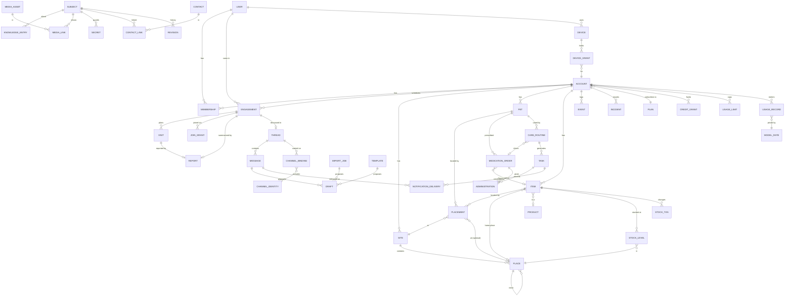

# 2. Domain model

This is the core's model. It has no AI, chat or UI concepts in it. Field types are logical (storage mapping is an adapter concern). `?` marks an optional field.

## 2.1 Conventions

Every entity has:

| Field | Type | Notes |
|---|---|---|
| `id` | UUIDv7 | Generated by the client or server; time-ordered; safe to create offline. |
| `account_id` | UUID | The tenant. Every query is scoped by it; no cross-account joins except through explicit sharing. |
| `created_at`, `updated_at` | instant (UTC) | |
| `created_by`, `updated_by` | actor ref | A user, the system, or an integration (see `Actor` below). |
| `version` | int | Increments on every write. Each version of a versioned entity is kept as a `Revision` (below). Used for optimistic concurrency and sync. |
| `deleted_at?` | instant | Soft delete, itself a revision; hard-deleted only by account deletion. |

Other conventions:
- **Instants** are UTC. **Local times** (for example `08:00` in a routine) are interpreted in a site's IANA `time_zone`. Only the kernel converts between the two, in either direction, using a pinned time-zone snapshot; apps and services never use the host's own time-zone data for schedules ([07 §7.5](07-portable-core.md#75-time)).
- **Quantities** are `{amount: decimal, unit: string}` with units from a fixed list (`count`, `tablet`, `capsule`, `ml`, `g`, `kg`, `cup`, `can`, `click`, `roll`, `bag`…).
- **Durations** are ISO 8601 (`PT8H`).
- **Names** have `aliases: string[]` wherever people search by name ("ear medicine" for Methimazole, "the hedgehog" for a toy).

### Versions & history

Records change all the time: owners edit instructions, sitters log doses, corrections fix mistakes. Any answer must be explainable afterwards ("why did it say to give Cerenia at 08:05?"), so history is never rewritten.

- **Every write makes a revision.** Every versioned entity keeps an immutable **`Revision`** per write: `{entity_id, version, snapshot, effective_from?, recorded_at, recorded_by (Actor), interface, command_id, reason?, cause?}`. Versioned entities are everything in the subject registry (2.2) plus knowledge entries, engagements, tasks, secrets and messages. `cause` links what prompted the change: a draft, a correction, an import. The current row is a projection of the latest revision in effect. `MedicationOrderRevision` (2.8) and `KnowledgeRevision` (2.10) follow this pattern with typed snapshots.
- **Two time axes.** *Effective time* is when something is true in the world: a revision's `effective_from`, a dose's `administered_at`, a sighting's `observed_at`. *Recorded time* is when the system learned it: `recorded_at`, set by the core from the clock port and never edited. For a record made on a device, it's when the data home received it; the device's own clock is kept as `device_time`. A dose given at 07:00 and reported at 08:12 carries both.
- **As-of reads.** Any query can be evaluated as of a recorded time ("what did the system know at 08:05?") and at an effective time ("what was the schedule on Monday?"). Because the core is deterministic and takes `now` from the clock port, an assistant answer can be replayed exactly (2.17), given the same kernel build and time-zone snapshot, which every answer records ([07 §7.8](07-portable-core.md#78-versions-replay-and-integrity)).
- **Facts are corrected, not edited.** Doses, sightings, task completions and stock transactions are append-only. A mistaken one is marked `entered_in_error` (who, when, why, and the correction that prompted it); computations ignore it from then on, and the right fact is recorded as a new record. Nothing disappears, so the log shows both what happened and what was believed at the time.
- **Edits start from a known version.** Every command that changes an existing record carries `expected_version`. If the record has changed in the meantime, the command fails with a conflict instead of overwriting. Drafts carry a `base_version` and go `stale` the same way (2.16).
- **Restoring is a new revision.** Going back to an older version writes a new revision with the old values, so history only grows.
- **Exceptions.** Secret values aren't kept in history: rotation destroys the old ciphertext, and only metadata revisions (who changed it, when) remain. Account deletion removes history along with everything else.

## 2.2 The subject registry

Knowledge, photos, contacts, events and permissions all need to point at "anything": a site, a place, a pet, an item or a medication order. Instead of loose polymorphic `(type, id)` pairs, each such entity registers once in a **subject** table that shares its id. Links then use real foreign keys.

| `Subject` | |
|---|---|
| `id` | Same UUID as the entity it registers |
| `account_id` | |
| `type` | `site` · `place` · `pet` · `item` · `medication_order` · `care_routine` · `contact` · `account` |

## 2.3 Overview

## 2.4 Identity, tenancy & access

**`User`**: a person who signs in. *Not account-scoped.*

| Field | Type | Notes |
|---|---|---|
| `display_name` | string | |
| `email?`, `phone?` | string | Contact points; the verified ones are in `verified_contacts[]`. A lightweight user joined by owner approval may have neither. |
| `locale`, `time_zone` | string | For notifications and display; schedules use the site's zone, not the user's. |
| `auth_subject` | string | Opaque id from the identity port (OIDC, passkeys…). |
| `kind` | enum | `full` · `lightweight` (created by a QR join: no password; can add a passkey later) |
| `identity_origin` | string | `cloud` (Pawsitter ID: one login across households) or `install:<install_id>` (local to one home install) ([08 §8.5](08-home-and-cloud.md#85-identity-and-sign-in)) |
| `verified_contacts[]` | | Phones and email addresses verified by a code. |
| `pid_subject?` | string | A linked Pawsitter account, for home users who link one. |

**`Account`**: the tenant.

| Field | Type | Notes |
|---|---|---|
| `name` | string | "Campbell household" |
| `kind` | enum | `household` · `pro_sitter` · `clinic` · `boarding` (only `household` in MVP) |
| `default_site_id?` | Site | |
| `plan_id`, `billing_anchor` | Plan, instant | The plan version, and when billing periods start (see 2.14). |
| `settings` | object | Feature flags, retention, the capability routing table ([03 §3.9.3](03-core-architecture.md#393-routing-by-sensitivity)), and for home installs the sign-in policy ([08 §8.6](08-home-and-cloud.md#86-home-sign-in-options)). |
| `data_home` | string | `cloud` or `install:<install_id>`: exactly one. Moving is export, import and cutover, never writing to both ([08 §8.16](08-home-and-cloud.md#816-moving-between-editions)). |

**`Membership`**: `(user_id, account_id)` unique.

| Field | Type | Notes |
|---|---|---|
| `role` | enum | `owner` · `admin` · `family` · `caregiver` |
| `status` | enum | `invited` · `active` · `suspended` · `left` |
| `scope?` | object | Optional restriction to some sites/pets for standing caregivers (a regular dog walker). |

**`JoinGrant`**: how a person joins an account by QR code or link ([08 §8.7](08-home-and-cloud.md#87-joining-by-qr)). It replaces the earlier `Invitation` and no-account `GuestLink`.

| Field | Type | Notes |
|---|---|---|
| `kind` | enum | `sent` · `window` (shown on a screen) · `printed_locator` |
| `engagement_id?`, `role`, `intended_user_id?` | | |
| `recipient_name`, `recipient_phone?`, `recipient_email?` | | The contact the owner entered. Codes go only here, never to a number typed on a public page. |
| `token_hash` or `locator_hash` | bytes | Only hashes are stored. A printed locator grants nothing on its own. |
| `join_check` | enum | `code` · `approval` · `owner_present` |
| `max_uses`, `uses`, `expires_at` | | Sent invites allow two devices by default and last until the trip's access ends, or 14 days after sending for an invite with no trip. |
| `rotated_from_id?`, `revoked_at?`, `reuse_attempts` | | Reuse of a spent secret alerts the owner. |

**`JoinRequest`**: a join waiting for its second factor: `grant_id`, `display_name`, device summary, `match_words`, `status` (`pending` · `approved` · `denied` · `expired`), `decided_by?`, `expires_at`. **`JoinWindow`**: a join window shown on a screen: `opened_by`, `engagement_id?`, `closes_at`, the current and previous nonce hashes, `max_joins`.

**`Device`**: one browser or app instance of a user: `user_id`, `label`, `created_via`, `session_hash`, `idle_expires_at`, `last_seen_at`, `last_transport`, `revoked_at?`.

**`DeviceGrant`**: one device's access to one account ([08 §8.5](08-home-and-cloud.md#85-identity-and-sign-in)).

| Field | Type | Notes |
|---|---|---|
| `device_id`, `account_id`, `engagement_id?` | refs | One grant per account, so a join in one household never opens another. |
| `auth_strength` | enum | How the grant was established: `passkey_uv` · `otp_verified` · `approved` · `pin` |
| `verified_until?`, `step_up_until?` | instant | Code verification (24 hours) and step-up (5 minutes), scoped to this device and this account. |
| `absolute_expires_at` | instant | For caregivers, no later than the trip's access end. |
| `ended_at?`, `upload_until?` | instant | When a trip ends, the grant is limited for 7 days to uploads of queued doses, completions and reveal logs dated inside the access window, and reads of the sitter's own events and the stay summary ([08 §8.8](08-home-and-cloud.md#88-revocation-ending-and-late-doses)). |
| `approved_by?`, `revoked_at?`, `revoked_by?`, `revoke_reason?` | | |

**`PasskeyCredential`**: `user_id`, `rp_id` (the cloud domain or a home install's name), credential id, public key, sign count, `last_used_at`, `revoked_at?`. **`PersonPin`** (home): a slow salted hash bound to one device, with a lockout counter. **`OwnerRecoveryKit`**: hashed one-time recovery codes per owner. **`SecurityEvent`**: sign-ins, joins, approvals, step-ups, reveals, revocations and remote locks. Owners can see them, they're kept at least 1 year, and home installs mirror them off the box ([08 §8.13](08-home-and-cloud.md#813-co-owners-and-account-safety)).

**`Installation`** (home only, one per install): `install_id`, `mode` (`connected` · `standalone`), hostname label or the owner's own name, certificate fingerprints and expiry, Home Link key id (connected only), enabled companion features or the owner's own services in their place, schema version, LAN paths, last heartbeat. For a connected install, the cloud keeps only the operational records listed in [08 §8.14](08-home-and-cloud.md#814-what-each-companion-service-stores-and-sees), and no care records except the discreet backup reminder schedule ([08 §8.10](08-home-and-cloud.md#810-outages-and-availability-at-home)). For a standalone install it keeps nothing ([08 §8.15](08-home-and-cloud.md#815-standalone-mode)).

**`Engagement`**: a care job that grants time-boxed access.

| Field | Type | Notes |
|---|---|---|
| `caregiver_user_id?` | User | Null until the sitter joins. |
| `approver_user_id?` | User | Someone the owner names (a family member or the backup contact) who can approve the trip's joins, reset PINs and reset locked invites while the owners are away ([08 §8.12](08-home-and-cloud.md#812-backups-keys-and-recovery-at-home)). |
| `title` | string | "Halloween weekend" |
| `care_mode` | enum | `drop_in` · `overnight` · `boarding` (pets go to another site) · `live_in` |
| `starts_at`, `ends_at` | instant | |
| `access_lead`, `access_lag` | duration | Access opens before the start and closes after the end (defaults `P1D` / `PT12H`). |
| `pet_ids[]`, `site_ids[]` | refs | What the caregiver can see and act on. |
| `permissions` | set | Defaults from the caregiver role; e.g. `secrets.reveal` off unless granted. |
| `status` | enum | `draft` · `proposed` · `confirmed` · `active` · `completed` · `cancelled` |
| `notes?` | text | Owner-to-caregiver notes for this job. |
| `vet_authorization?` | object | `{may_authorize, spending_limit?, exclusions[], try_owner_first, notes?}`: whether the caregiver may approve treatment, up to what amount, never what (e.g. euthanasia). Shown on the emergency card during the engagement. |
| `returned_at?` | instant | Set by "I'm home": the engagement completes and household access closes immediately, without `access_lag`. |
| `summary_report_id?` | Report | The stay summary sent at handback (2.12). |

**`Visit`**: one planned visit inside a `drop_in` engagement (overnight stays can have one long visit).

| Field | Type | Notes |
|---|---|---|
| `engagement_id`, `site_id` | refs | |
| `planned_start`, `planned_end` | instant | |
| `checked_in_at?`, `checked_out_at?` | instant | Optional geofence check via the location port (V2). |
| `status` | enum | `planned` · `in_progress` · `completed` · `missed` · `cancelled` |
| `report_id?` | ref | The visit report sent to the owner. |

**`Actor`** (value object on every write and event): `{kind: user | system | integration, user_id?, device_id?, auth_method?, integration?: "assistant" | "mcp" | "discord" | ..., on_behalf_of_user_id?}`. Every action shows who did it and on which device. When an AI assistant acts, the event says *assistant on behalf of Jane*.

## 2.5 Sites & places

**`Site`**: a real-world location.

| Field | Type | Notes |
|---|---|---|
| `name` | string | "Home", "Happy Paws Clinic", "Lake house" |
| `kind` | enum | `home` · `vacation_home` · `clinic` · `boarding` · `daycare` · `groomer` · `vehicle` · `park` · `other` |
| `ownership` | enum | `owned` (the account manages its places and items) · `external` (a reference: name, address, contacts only) |
| `address?` | structured | |
| `geo?` | lat/lng + radius | For check-in geofences. Sensitive. |
| `time_zone` | IANA string | **Required.** All routines at this site use it. Kept exactly as entered and resolved through the time-zone snapshot's link table every time it's used ([07 §7.5](07-portable-core.md#75-time)). |
| `aliases[]` | string[] | |
| `root_place_id` | Place | Every owned site has a root place; places hang off it. |

**`Place`**: a spot within a site, nested to any depth.

| Field | Type | Notes |
|---|---|---|
| `site_id` | Site | Denormalized for fast queries; must equal the parent's site. |
| `parent_id?` | Place | Null only for the root place. |
| `name` | string | "Pantry", "Shelf 2", "Blue airtight container" |
| `kind` | enum | `root` · `floor` · `room` · `zone` · `furniture` · `shelf` · `drawer` · `container` · `outdoor` · `other` |
| `path` | materialized path | E.g. `/home/kitchen/pantry/shelf-2/`; rebuilt on move; enables subtree queries ("everything in the kitchen"). |
| `description?` | text | "Second shelf from the top" |
| `backing_item_id?` | Item | Set for **portable containers** (carrier, go-bag): the place's real location is wherever that item is placed. V2. |
| `aliases[]`, `sort_order` | | |

## 2.6 Trackables: pets & items

Pets and items share location tracking, aliases and photos, so both specialize a **`Trackable`** (class-table inheritance: one `trackable` row plus one `pet` or `item` row with the same id).

**`Trackable`** (shared fields)

| Field | Type | Notes |
|---|---|---|
| `kind` | enum | `pet` · `item` |
| `name`, `aliases[]` | | |
| `current_site_id?`, `current_place_id?` | refs | **Denormalized** from the latest open `Placement`, for fast "where is X". |
| `current_placement_id?` | Placement | |
| `profile_media_id?` | MediaAsset | |

**`Pet`**

| Field | Type | Notes |
|---|---|---|
| `species` | enum + text | `cat`, `dog`, `rabbit`, `bird`, `fish`, `reptile`, `other` + free text |
| `breed?`, `sex?`, `neutered?`, `birth_date?` (or estimated) | | |
| `color_markings?`, `microchip_id?` | | Microchip is private-sensitivity. |
| `status` | enum | `active` · `deceased` · `rehomed` |
| `home_site_id` | Site | Where the pet normally lives. |

**`Item`**

| Field | Type | Notes |
|---|---|---|
| `category_id` | Category | Tree: Toys, Food, Medication, Supplies › Cleaning, Equipment, Documents… |
| `product_id?` | Product | Brand/barcode identity (V2). |
| `tracking` | enum | `unique` (one physical thing: the hedgehog toy, the carrier) · `consumable` (a supply measured in stock: poop bags, wipes, cat food) |
| `home_place_id?` | Place | **Where it belongs.** Distinct from where it currently is. |
| `pet_ids[]` | refs | Whose it is, if anyone's (Biscuit's leash). |
| `default_unit?` | unit | For consumables. |
| `expires_on?` | date | V2. |
| `sensitivity` | enum | `normal` · `private` (e.g. prescription bottles: labels show name and address) |

**`Placement`**: where a trackable is or was. Append-only history; a wrong sighting is marked `entered_in_error`, not deleted (2.1).

| Field | Type | Notes |
|---|---|---|
| `trackable_id` | Trackable | |
| `site_id` | Site | Required: we always know at least the site. |
| `place_id?` | Place | Must belong to `site_id`. |
| `with_user_id?` | User | "With the sitter on a walk", "in Jane's car". |
| `kind` | enum | `moved` (someone deliberately moved it) · `seen` (observed there) · `inferred` (e.g. from a boarding engagement) · `returned_home` |
| `observed_at` | instant | |
| `ended_at?` | instant | Set when superseded. **Exactly one open placement per trackable.** |
| `note?`, `media_id?` | | "Under the couch" + photo |

Why both `home_place_id` and `Placement`: people ask both "where does it go?" and "where is it?". The answer to "where is the leash?" is the last placement if recent, otherwise the home place: "it lives in the front-door basket; last seen there yesterday".

**`Category`**: account-specific tree seeded from a global template. `name`, `parent_id?`, `icon?`.

**`Product`** (V2): global or account-scoped catalog. `name`, `brand?`, `barcode?`, `category_id`, `default_unit`, `package_size?`, `media_id?`, `is_medication`, `drug?` (active ingredient, strength, form).

## 2.7 Inventory

**`StockLevel`**: how much of a consumable is at a place. Unique on `(item_id, place_id)`.

| Field | Type | Notes |
|---|---|---|
| `item_id` | Item (`tracking = consumable`) | |
| `place_id` | Place | |
| `level` | enum | `plenty` · `low` · `out`. Set directly by anyone in scope, or derived from `quantity` and `low_threshold` for counted supplies. |
| `quantity?` | Quantity | Current amount, only for supplies the household chooses to count. |
| `low_threshold?`, `target_level?` | Quantity | For counted supplies: alert when quantity ≤ threshold; the shopping list fills up to the target. |
| `counted_at?` | instant | Last physical count. |

**`StockTransaction`**: every change, immutable.

| Field | Type | Notes |
|---|---|---|
| `item_id`, `place_id` | refs | |
| `delta` | Quantity | Negative for use. |
| `reason` | enum | `restock` · `consumed` · `count_adjustment` · `transfer_in` · `transfer_out` · `expired` · `lost` · `reversal` |
| `reverses_id?` | StockTransaction | For `reversal`: the mistaken transaction it cancels. Transactions are never edited or deleted. |
| `task_id?`, `administration_id?` | refs | Auto-consumption from feeding tasks or doses (V2). |
| `occurred_at` | instant | |

For counted supplies, `StockLevel.quantity` always equals the sum of its transactions (kept in the same write). Uncounted supplies have no transactions; each level change is an event (`stock.level_changed`).

**`ShoppingListEntry`**: `item_id`, `quantity?`, `source` (`low_stock` | `manual`), `status` (`open` | `bought` | `dismissed`). A supply turning `low` or `out` opens a `low_stock` entry.

## 2.8 Medications

Safety-critical, so fully structured. The owner's own words are kept alongside the structure, never replaced by it.

**`MedicationOrder`**: a subject.

| Field | Type | Notes |
|---|---|---|
| `pet_id` | Pet | |
| `drug_name` | string | "Ondansetron" (+ `aliases[]`: "anti-nausea", "Zofran") |
| `product_id?` | Product | E.g. Maropitant citrate 24 mg = Cerenia. |
| `strength?` | string | "4 mg", "5 mg/0.1 ml" |
| `form` | enum | `tablet` · `capsule` · `liquid` · `transdermal_pen` · `injection` · `topical` · `powder` · `other` |
| `dose` | Quantity | `0.5 tablet`, `2 click` |
| `route` | enum | `oral` · `ear_skin` (transdermal) · `topical` · `injection` · `eye` · `other` |
| `administration_method?` | text | "Spread in the ear flap"; "mix half capsule powder into food" |
| `schedule_kind` | enum | `scheduled` · `as_needed` (PRN) |
| `min_interval?` | duration | `PT8H`. Enforced for both kinds. |
| `max_doses_per_window?` | `{count, window}` | E.g. 1 per `PT24H`. |
| `not_before?` | `{at: instant, local?, zone?, snapshot_id?}` | One-off lockout ("not until Tue 08:00"). `can_administer` checks `at`. When the owner gave a local time, it's kept with the zone and the snapshot that converted it, so a time-zone update re-derives `at` and alerts caregivers ([07 §7.5](07-portable-core.md#75-time)). |
| `prn_indication?` | text | When to give an as-needed dose ("if he won't take his meds"; "if vomiting"). |
| `starts_on`, `ends_on?` | local date | Kept as entered, with their zone. The instants they bound are derived with a recorded `snapshot_id`, and re-derived when a time-zone update moves them. |
| `instructions_verbatim` | text | **Exactly as the owner or label wrote it.** Shown next to any computed answer. |
| `if_missed?` | text | What to do when a dose is late or missed, in the owner's words ("Don't double up. Call the vet if two doses are missed."). Shown with every overdue reminder. |
| `if_refused?` | text | What to do when the pet refuses or spits out a dose. |
| `alert_owner_on` | set | Outcomes that alert the owner at once. Default: `refused`, `spat_out`, `vomited_after`, `skipped`, and a dose turning `missed`. |
| `item_id?` | Item | The physical bottle/pen and therefore where it's kept. |
| `prescriber_contact_id?` | Contact | |
| `status` | enum | `active` · `paused` · `completed` · `discontinued` |

Changes to dose, interval or limits create a new **`MedicationOrderRevision`** (`order_id`, snapshot, `effective_from`, `changed_by`, `changed_at`, `reason`), the general `Revision` (2.1) with `changed_at` as its recorded time. A revision can take effect in the future, so a taper ("½ tablet from Monday, ¼ from the 20th") is a series of dated revisions. A dated revision keeps the local date and time it was given, and the zone, beside the derived `effective_from` instant and its `snapshot_id`, so a time-zone update re-derives it. Administrations reference the revision in force at the time of the dose, and `can_administer` uses it.

**`Administration`**

| Field | Type | Notes |
|---|---|---|
| `order_id`, `order_revision_id` | refs | |
| `task_id?` | Task | Null for as-needed doses. |
| `status` | enum | `given` · `partial` · `refused` · `spat_out` · `vomited_after` · `skipped` · `not_needed` |
| `dose_given?` | Quantity | Defaults to the ordered dose. |
| `administered_at` | instant | When it actually happened (may be back-dated, with `recorded_at` kept separately). |
| `recorded_at`, `recorded_by` | | |
| `device_id`, `device_time` | | Where it was recorded, and the device's clock at the time. `recorded_at` is when the server received it, so as-of replays see exactly what the server knew ([07 §7.7](07-portable-core.md#77-where-answers-are-authoritative)). |
| `kernel_sha256`, `snapshot_id` | | The kernel build and time-zone snapshot that checked it. |
| `check?` | `{decision, reasons[], confirmed_by?, override_reason?}` | What `can_administer` answered when the dose was started from the app, and who went past it. |
| `outside_limits?` | `{reasons[]}` | Set when a dose that already happened broke the limits. It's recorded anyway, and the owner and caregivers are alerted at once (invariant 6). |
| `note?`, `media_id?` | | |
| `entered_in_error?` | `{at, by, reason, correction_id?}` | Set instead of deleting a mistaken record. `can_administer` ignores it from then on; the history keeps it. |

Administrations are append-only events. They never go through optimistic version checks, so a dose that really happened can't be lost in a sync conflict. Recording one never fails because its task changed: the administration is stored and linked to its task, and a dose that was given marks the task done, all without the task's version check, so its reminders stop. A task can hold several. A second dose given for the same task is recorded and alerts the owner at once, even within the limits, and is marked `outside_limits` if it broke them.

**Derived, never stored by an LLM**: `can_administer(order, at)` returns `{decision, reasons, next_allowed_at, last_given_at, doses_in_window, history_confirmed_at, snapshot_id}` from the order revision, `not_before`, `min_interval`, `max_doses_per_window` and the administrations. `decision` is `allowed` (shown as "yes"), `denied` (shown as "not yet") or `unverified` (shown as "can't confirm"): unverified when the dose history hasn't been confirmed by the server within a freshness bound, or a clock looks wrong. If the clock looks right and what's on record already rules the dose out, the answer is `denied`, however old the history. Doses recorded on other devices are widened by a clock-skew margin. Errors and `unverified` fail closed: no dose without the caregiver's explicit confirmation (invariant 6) ([07 §7.7](07-portable-core.md#77-where-answers-are-authoritative)). Windows are rolling durations over instants. Statuses `vomited_after` and `spat_out` still count as given for safety limits unless the order says otherwise.

## 2.9 Care routines & tasks

**`CareRoutine`**: a subject.

| Field | Type | Notes |
|---|---|---|
| `title` | string | "Breakfast", "Methimazole", "Scoop litter box" |
| `kind` | enum | `feeding` · `medication` · `walk` · `litter` · `grooming` · `play` · `cleaning` · `check` · `custom` |
| `pet_ids[]` | refs | Empty for household chores. |
| `site_id?` | Site | Applies only at this site; null = wherever the pet currently is (its time zone follows the pet). |
| `medication_order_id?` | MedicationOrder | Required when `kind = medication`; dose comes from the order. |
| `recurrence` | union | See below. |
| `window_before`, `window_after` | duration | The on-time window around each due time (e.g. `PT30M` / `PT1H`). |
| `grace_after` | duration | After this, an incomplete task becomes `missed`. |
| `instructions?` | text | "½ can wet food in his blue bowl" |
| `consumes?` | `[{item_id, quantity}]` | Auto stock decrement on completion (V2). |
| `requires_evidence` | enum | `none` · `note` · `photo` |
| `reminder_policy` | object | `{remind_before, repeat_every, escalate_after, escalate_to[]}`. Defaults by kind: medications remind at the due time, repeat every 10 minutes until answered, and escalate to the owner after 30 minutes, then to a backup contact. Feeding reminds once. See 2.15. |
| `active_from?`, `active_until?` | instant | |
| `engagement_id?` | Engagement | Routine only during this job (e.g. boarding instructions). |
| `status` | enum | `active` · `paused` · `archived` |

`recurrence` is one of:
- **Calendar**: `{type: "calendar", rrule: "FREQ=DAILY", times: ["08:00","20:00"], gap_policy: "shift_forward", snapshot_id}`, stored as local wall time in the site's time zone. DTSTART, EXDATE, UNTIL and single-occurrence overrides are local values too. Instants come only from expansion, which is redone when the time-zone snapshot changes. `gap_policy` says what happens to a time that doesn't exist on the night clocks go forward (Q26). `shift_forward` moves it later by the length of the gap. The full recurrence rules are in [07 §7.5](07-portable-core.md#75-time).
- **Interval**: `{type: "interval", every: "PT8H", anchor: "last_completion" | "start", first_due?: instant}`. Next due = last completion + interval. Needed for "every 8 hours" medications.
- **One-off**: `{type: "once", due_local, snapshot_id}`: a local date and time in the site's zone, expanded like calendar times.

**`Task`**: one occurrence. Unique on `(routine_id, occurrence_key)` so generation is idempotent: for calendar and one-off routines, the local date and time it was generated for, before any gap shift; for interval routines, its number in the series. A time-zone update that moves `due_at`, or a change to the completion an interval task is anchored on, updates the task instead of creating a second one.

| Field | Type | Notes |
|---|---|---|
| `routine_id` | CareRoutine | |
| `occurrence_key` | string | See above. |
| `due_at` | instant | |
| `window_start`, `window_end` | instant | From the routine's windows. |
| `status` | enum | `upcoming` · `due` · `done` · `late` (done after the window) · `skipped` · `missed` · `cancelled` |
| `completed_at?`, `completed_by?` | | |
| `skip_reason?`, `note?` | text | |
| `evidence_media_ids[]` | refs | |
| `visit_id?` | Visit | Which visit it was done in. |
| `administration_ids[]` | Administration | For medication tasks. More than one can mean a retry, such as a dose given after a refusal, or a dose recorded twice. |

Calendar tasks are **materialized ahead** for a rolling horizon (e.g. 14 days) by a scheduler job, on routine change, and whenever their instants move: a new time-zone snapshot, a new zone for the site, or, for a routine without a site, the pet moving to a site in another zone. A task that isn't done, skipped or cancelled gets the new `due_at` and window as a new revision, its reminders are rescheduled, and caregivers are told the time moved ([07 §7.5](07-portable-core.md#75-time)). Done and skipped tasks keep their instants. Interval tasks are materialized one at a time: the next is created when the previous one completes. `upcoming` / `due` / `missed` are derived from the clock, and the stored status is only updated by the job for notifications, so reads are always correct even if the job is late.

**Derived queries**: `today(site or pet, at)`, `whats_next(scope, at)`, `overdue(scope, at)`, `last_done(routine)`. Each returns structured rows; an AI may phrase them.

## 2.10 Knowledge, secrets & contacts

**`KnowledgeEntry`**

| Field | Type | Notes |
|---|---|---|
| `subject_id` | Subject | What it's about: a pet, item, place, site, medication order, or the account. |
| `kind` | enum | `instruction` · `note` · `behavior` · `baseline` (what's normal for this pet: hairballs, limping after naps) · `preference` (favorite toy/spot) · `rule` (house rule) · `playbook` (emergency steps, with "watch and wait" vs. "call the vet now" thresholds) |
| `title` | string | "If Sonic vomits" |
| `body` | markdown | |
| `steps?` | `[{order, text, contact_id?}]` | For playbooks. |
| `related_subject_ids[]` | refs | "Favorite spot" links the pet *and* the place. |
| `tags[]` | | |
| `sensitivity` | enum | `normal` · `private` (owners/family only). Secrets are a separate entity. |
| `priority` | enum | `critical` (always shown, e.g. "never let him out the back door") · `normal` |
| `valid_from?`, `valid_until?` | instant | Temporary notes ("fridge is broken this week"). |
| `current_revision_id` | KnowledgeRevision | |

**`KnowledgeRevision`**: immutable `{entry_id, title, body, steps, edited_by, edited_at}`.

**`Secret`**

| Field | Type | Notes |
|---|---|---|
| `subject_id` | Subject | Usually a site ("Alarm code") or the account ("Wi-Fi"). |
| `label` | string | Not secret. |
| `ciphertext`, `key_id` | bytes | Envelope-encrypted via the crypto port; the plaintext never sits in the main database. `key_id` names where the key lives (cloud KMS or the owner's edge node, [03 §3.9.4](03-core-architecture.md#394-trade-off-parts-at-home-can-go-offline)). |
| `reveal_policy` | enum | `members` · `engaged_caregivers` · `owners_only` |
| `assistant_access` | enum | `never` (default) · `on_request`: whether AI adapters may ever receive it. |
| `needed_outside` | bool | Needed to get in, such as a door or lockbox code. For a home install, readiness checks that the owner has a fallback, or that it can be staged on the sitter's phone and is once access opens ([08 §8.10](08-home-and-cloud.md#810-outages-and-availability-at-home)). |

**`SecretReveal`**: `{secret_id, revealed_to, actor, device_id, step_up_method, transport, at, interface}`. Every reveal is logged, and the owner can see the log.

**`SecretStaging`** (home): `{secret_id, device_id, engagement_id, staged_at, expires_at}`. Readiness, the revoke dialog and the after-trip rotation prompt use it to name every code staged to a device ([08 §8.10](08-home-and-cloud.md#810-outages-and-availability-at-home)).

**`Contact`**: `name`, `organization?`, `kind` (`vet` · `emergency_vet` · `owner` · `family` · `neighbor` · `groomer` · `walker` · `sitter` · `pharmacy` · `other`), `phones[]`, `email?`, `address?`, `hours?`, `notes?`, `user_id?` (if they're also a user).

**`ContactLink`**: `{contact_id, subject_id, role}`, e.g. `(Happy Paws, Sonic, primary_vet)` and `(City Animal ER, Home site, emergency_vet)`.

## 2.11 Media

Photos, videos, voice messages and documents are all **`MediaAsset`s**, stored through the `BlobStore` port. They attach in two ways: to subjects (a pet, item, place, site or medication order) through a **`MediaLink`**, and to events through those records' own `media_ids[]`: a task's evidence, an administration, an incident, a care-thread message (2.17) or a report.

**`MediaAsset`**

| Field | Type | Notes |
|---|---|---|
| `kind` | enum | `photo` · `video` · `audio` (a voice message) · `document` (a PDF, such as a vaccination certificate) |
| `status` | enum | `uploading` · `processing` · `ready` · `failed` · `deleted`. Only `ready` assets are linked or shown (invariant 8). |
| `storage_key` | string | Opaque key in the blob-store port, naming its provider, for the processed file. The upload as received is deleted once processing succeeds, so no copy with metadata is kept. |
| `mime_type`, `bytes`, `sha256` | | Of the processed file. Dedup by hash within an account. |
| `width?`, `height?`, `duration_ms?` | | |
| `captured_at?` | instant | When it was taken, as the device reported it: the only detail read from the file's metadata before that's removed. |
| `uploaded_by` | Actor | Who added it, from which device. |
| `source` | enum | `app` · `web` · `sms` · `discord` · `whatsapp` · `email` · `import`. Adapters download channel media at once, because channel links expire. |
| `metadata_stripped` | bool | **Must be true** before the asset is linked; EXIF, GPS and other metadata removed on ingest. |
| `sensitivity` | enum | `normal` · `private` (e.g. prescription labels) |
| `variants[]` | `{purpose, storage_key, mime_type, width?, height?, bytes}` | `thumb` and `display` for photos and a document's first page; `poster` (a still) and `playback` for videos; `playback` for voice messages. Re-encoded to formats every supported browser shows: JPEG or WebP (Chrome and Firefox can't show iPhone HEIC photos), H.264 video and AAC audio. |
| `transcript?` | `{text, language, made_by, confidence?}` | For voice messages and videos with speech: made through the `ModelGateway` (purpose `transcription`), shown as "transcribed automatically", and searchable. It never records anything by itself (below). |
| `alt_text?` | text | For screen readers: written by a person, or drafted by the vision port and confirmed. |
| `deleted_at?`, `deleted_by?` | | Deleting removes the file and every variant. The record stays, so history shows "photo deleted". |

**`MediaLink`**: `{media_id, subject_id, role, caption?, sort_order}` where `role` is `profile` · `reference` (what it looks like / where it is) · `label` · `evidence` · `document`.

**Rules.**
- Phones shrink photos and videos before uploading, to save data on mobile networks and through the relay; the server still strips metadata itself.
- Proposed MVP limits (Q35): photos up to 25 MB, videos up to 60 seconds, voice messages up to 2 minutes, documents up to 20 MB. How long media history is kept depends on the plan ([00 §0.7](00-product-offering.md#07-packaging-proposal)).
- Media recorded offline waits in the phone's outbox. A dose or task completion it belongs to syncs without waiting for it.
- A transcript is a model's reading of someone's words and can be wrong ("fifteen" heard as "fifty"). The assistant may read it, but a dose or change it mentions becomes a draft the speaker confirms, with the recording beside it ([04 §4.4](04-permissions-privacy.md#44-ai-and-external-interfaces)).
- `private` media are never sent on outside channels. SMS, Discord, WhatsApp and email get a link instead, which opens the app after sign-in.

## 2.12 Incidents & events

**`Incident`**

| Field | Type | Notes |
|---|---|---|
| `pet_ids[]`, `site_id?` | refs | |
| `type` | enum | `vomiting` · `diarrhea` · `not_eating` · `injury` · `escaped` · `behavior` · `property` · `other` |
| `severity` | enum | `info` · `concern` · `urgent` · `emergency` |
| `occurred_at`, `description`, `media_ids[]` | | |
| `status` | enum | `open` · `acknowledged` · `resolved` |
| `playbook_entry_id?` | KnowledgeEntry | The playbook that was followed. |

Severity `urgent` or higher notifies owners immediately through every enabled channel.

**`Event`**: the append-only activity log.

| Field | Type | Notes |
|---|---|---|
| `type` | string | `task.completed`, `medication.administered`, `trackable.moved`, `stock.adjusted`, `stock.low`, `incident.reported`, `secret.revealed`, `engagement.started`, … |
| `occurred_at`, `recorded_at` | instant | |
| `actor` | Actor | Including the interface it came through. |
| `subject_ids[]` | refs | For per-pet / per-site feeds. |
| `engagement_id?`, `visit_id?` | refs | For visit reports. |
| `payload` | object | Versioned schema per type. |
| `correlation_id?` | UUID | Ties together events from one command. |

**`Report`**: an update sent to the owner, built from events.

| Field | Type | Notes |
|---|---|---|
| `kind` | enum | `visit` · `daily` · `stay` (the summary at handback) |
| `engagement_id?`, `visit_id?` | refs | |
| `range` | `{from, to}` instants | |
| `sections` | object | Tasks on time, late and missed; doses and their outcomes; incidents; supply changes. Always present. |
| `media_ids[]` | refs | Photos taken in the range. |
| `prose?` | text | Optional summary from the `LanguageModel` port. The structured sections never depend on it. |
| `sent_at?` | instant | |

**`DecisionRecord`**: one safety-relevant kernel answer, append-only: `op`, `request` and `response` (exact bytes), `kernel_sha256`, `snapshot_id`, host and engine, `device_id?`, `computed_at`, and the `message_id?` or `administration_id?` it supports. Written for every `can_administer` answer shown when a dose is started, and for every answer the assistant quotes. Records made on devices sync with the event log ([07 §7.8](07-portable-core.md#78-versions-replay-and-integrity)).

## 2.13 Health records (V2)

`WeightRecord` (`pet_id`, `weight`, `measured_at`), `Condition` (`name`, `diagnosed_on`, `status`, notes), `Vaccination` (`vaccine`, `given_on`, `due_on`, `clinic_contact_id`), `VetVisit` (`site_id`, `date`, `reason`, `summary`, documents via `MediaLink role=document`).

In MVP, vaccination certificates and vet documents attach to the pet as `MediaLink role=document`, so boarding and daycare can be shown proof before structured records exist.

## 2.14 AI usage & allotments

Hosted model calls and SMS messages are metered per account (see [03 §3.10](03-core-architecture.md#310-ai-usage-metering)). Usage records hold counts and costs, never prompt, reply or message text.

**`Plan`**: *not account-scoped; versioned.* `code`, `name`, `period` (e.g. `P1M`), `credits_per_period`, `default_limits[]` (`UsageLimit` templates), `features` (flags). Accounts point at a plan version, so editing a plan never silently changes existing accounts.

**`ModelRate`**: *not account-scoped.* A new row for every price change, so past usage keeps the rate it was charged at.

| Field | Type | Notes |
|---|---|---|
| `provider`, `model` | string | E.g. `hosted:claude` and the model id |
| `effective_from` | instant | |
| `cost_per_mtok` | `{input, output, cache_write, cache_read}` money | What the provider charges us per million tokens |
| `credits_per_mtok` | `{input, output, cache_write, cache_read}` decimal | What the customer is charged. Proportional to cost = cost-based credits; equal across models = token-based; anything between is a blend. |
| `cost_per_image?`, `credits_per_image?` | | For vision calls |
| `cost_per_audio_minute?`, `credits_per_audio_minute?` | | For transcription |

**`UsageRecord`**: the immutable ledger, one row per model call.

| Field | Type | Notes |
|---|---|---|
| `occurred_at` | instant | |
| `actor`, `interface` | | Who caused it and through which interface (`system` for automatic visit reports) |
| `capability` | enum | `language_model` · `vision` · `sms` (later `embedding`, `speech`) |
| `purpose` | enum | `assistant` · `care_note_import` · `visit_report` · `photo_lookup` · `summary` · `sitter_reminder` · `transcription` · … |
| `provider`, `model`, `rate_id` | | The rate in force at the time |
| `tokens` | `{input, output, cache_write, cache_read}` int | As reported by the provider |
| `images` | int | |
| `audio_seconds` | int | For transcription |
| `provider_cost` | money | Exact decimal in micro-units of the currency |
| `credits` | decimal | |
| `billable` | bool | False for the owner's edge node or an owner-supplied provider key |
| `outcome` | enum | `ok` · `error` · `cancelled` (failed calls can still use tokens) |
| `reservation_id`, `correlation_id`, `engagement_id?` | refs | `correlation_id` groups the calls of one assistant turn |

**`CreditGrant`**: credits added to an account.

| Field | Type | Notes |
|---|---|---|
| `amount`, `remaining` | decimal | |
| `source` | enum | `plan_period` · `top_up` (V2) · `promo` · `adjustment` |
| `valid_from`, `expires_at?` | instant | The plan's grant expires at the end of its period; top-ups may last longer |

The **credit balance** is the sum of unexpired grants' `remaining`. Usage draws from the soonest-expiring grant first.

**`UsageLimit`**: an extra cap, checked with the balance before every billable call.

| Field | Type | Notes |
|---|---|---|
| `metric` | enum | `credits` · `tokens` · `cost` · `requests` |
| `window` | enum + duration | `billing_period` · `rolling` (`P1D`, `PT1H`, `PT1M`) · `turn` (one assistant turn) |
| `amount` | decimal | |
| `scope` | object | `account` · `member` (user) · `engagement` · `purpose` · `integration` |
| `on_exceed` | enum | `block` · `degrade` (try the next provider) · `allow_overage` (later) |
| `warn_at[]` | percent | Default `[80, 100]` |
| `source` | enum | `plan` · `owner` (may only tighten the plan's limits) · `admin` |

**`UsageReservation`**: the estimated maximum use of one call, held until it settles: `estimate` (`{credits, tokens, cost, requests}`), `limit_ids[]`, `expires_at`, `status` (`held` · `settled` · `released` · `expired`).

**`UsageCounter`**: derived and rebuildable from the ledger, like `StockLevel` from stock transactions: `(limit_id, window_start)` → `used`, `reserved`.

## 2.15 Notifications & reminders

Reminders that fire reliably are the most valued feature in the category ([06 #1](06-feature-research.md#63-ranked-features)), so every message is tracked from sent to answered.

**`NotificationPreference`**: per user per account.

| Field | Type | Notes |
|---|---|---|
| `channels` | list | In order of preference: `native_push` · `web_push` · `email` · `sms`, plus any outside channel enabled for the account (`whatsapp`, `discord`, …). |
| `quiet_hours?` | `{from, to}` local times | |
| `medication_overrides_quiet_hours` | bool | Default true. |
| `discreet` | bool | Keep medication names and health details off lock screens and out of SMS text; show the routine's title instead. |

**`NotificationDelivery`**: one copy of something sent to one recipient on one channel: a reminder, an alert, or a care-thread message fanned out to a participant (2.17).

| Field | Type | Notes |
|---|---|---|
| `recipient`, `device_id?` | User | Sitters without the app get medication reminders by SMS, and the rest by email or web push. |
| `channel` | enum | `native_push` (APNs or FCM; through Pawsitter's push relay for home installs) · `web_push` · `email` · `sms` · `whatsapp` · `discord` · … |
| `message_id?`, `external_message_id?` | | For care-thread copies: the message, and its id on the channel, so a reply there maps back to it. |
| `kind` | enum | `reminder` · `escalation` · `dose_alert` · `incident` · `update` · `report` · `readiness` · `thread` · `correction` · `join_request` · `security` |
| `task_id?`, `subject_ids[]` | refs | |
| `sent_at`, `delivered_at?`, `opened_at?`, `answered_at?` | instant | Receipts where the channel provides them. |
| `superseded_at?` | instant | Set when someone completes the task: the reminder is withdrawn on every device. |
| `status` | enum | `queued` · `sent` · `delivered` · `failed` · `answered` · `superseded` |

**`PushSubscription`**: a web push subscription per device and origin: endpoint, keys, VAPID key id, failure count. It's deleted when the push service reports it gone. **`NativePushRegistration`**: a native shell's registration. For home installs, only Pawsitter's push relay holds the device token.

Delivery rates per channel feed the `DeliveryMonitor` job ([03 §3.6](03-core-architecture.md#36-background-jobs-jobscheduler-port)). When a channel fails for a recipient, the next one in their list is tried.

## 2.16 Setup: templates & import drafts

Setup must take minutes, not an evening ([06 #6](06-feature-research.md#63-ranked-features)). Templates, AI import and corrections in a care thread (2.17) all produce **drafts**; nothing becomes a record until a person accepts it.

**`Template`**: *not account-scoped.* A starter set such as `cat`, `dog`, `puppy` or `senior_on_medication`: routines, knowledge prompts ("What's normal for her?"), playbooks and place suggestions.

**`ImportJob`**: an owner's pasted care note being turned into drafts. `source_text` (private; kept until the job is done, then deleted unless the owner keeps it), `masked_secrets` (likely codes and passwords found locally before any model sees the text), `written_on` (the day the note was written, which the owner confirms, because times given in words count from it), `status` (`drafting` · `ready` · `done` · `failed`), `usage_record_ids[]`.

**`Draft`**: a proposed record waiting for a person.

| Field | Type | Notes |
|---|---|---|
| `import_job_id?`, `template_id?`, `source_message_id?` | refs | Where it came from: a template, an import, or a correction in a care thread. |
| `action` | enum | `create` · `revise` (change an existing record) · `record` (log something that happened, such as a dose given before the owner left) |
| `target_type` | enum | `care_routine` · `medication_order` · `administration` · `task` · `placement` · `contact` · `place` · `item` · `knowledge_entry` · `secret` |
| `target_id?` | ref | The record a `revise` changes. |
| `base_version?` | int | The target's version when the draft was made. If the target has changed since, the draft goes `stale` and is re-drafted against the new version. |
| `proposed` | object | Field values, validated against the target's schema. |
| `source_excerpt?` | text | The words it came from. For a new medication order this becomes `instructions_verbatim`; for a correction it's the owner's message. |
| `times_in_words[]` | `{text, fields, reference_date, resolved?, candidates[]}` | Times the source gives in words ("until Tuesday morning"): the words, the fields the model read, the date they count from, and what the kernel resolved. With more than one candidate, the draft can't be accepted until the owner picks one (invariant 29). |
| `status` | enum | `pending` · `accepted` · `edited_and_accepted` · `rejected` · `stale` |
| `decided_by?`, `decided_at?` | | |

## 2.17 Care threads & channels

Every answer the assistant gives a caregiver during an engagement lives in a thread the owner can see and correct ([01 §1.14](01-features.md#114-care-thread--ai-oversight), [03 §3.8.2](03-core-architecture.md#382-owner-corrections)). People reach that thread on different channels: the app, the website, SMS, WhatsApp, Discord. It stays one conversation however many channels carry it ([03 §3.8.3](03-core-architecture.md#383-one-thread-many-channels)).

**`Thread`**: a conversation, independent of any channel.

| Field | Type | Notes |
|---|---|---|
| `scope` | enum | `engagement` (one per trip, shared with everyone on it) · `household` (family, outside trips; V2) · `direct` (one member and the assistant; private to them) |
| `engagement_id?` | Engagement | For `engagement` threads. |
| `participants` | refs | Users. The assistant posts as itself. |
| `notify_policy` | enum | `important` (medication, health and incidents notify the owner at once; the default) · `every_answer` |

**`ChannelIdentity`**: an account on an outside channel, verified as a particular person in this household's account.

| Field | Type | Notes |
|---|---|---|
| `channel` | enum | `sms` · `whatsapp` · `discord` · `slack` · `telegram` · `email` · … |
| `external_user_id` | string | A phone number, a WhatsApp id, a Discord user id. Unique per channel within the account. |
| `user_id` | User | Who it is. |
| `verified_at`, `verified_by` | | Verified with a one-time code sent through that channel, or linked by the owner. |
| `revoked_at?` | instant | |

**`ChannelBinding`**: one outside conversation that carries a thread. In-app and web conversations need none, because those channels are ours.

| Field | Type | Notes |
|---|---|---|
| `thread_id` | Thread | |
| `channel` | enum | |
| `external_conversation_id` | string | A WhatsApp chat, a Discord DM or private thread, an SMS number pair. |
| `identity_ids[]` | ChannelIdentity | Who is in it: participants of the thread and nobody else ([04 §4.9](04-permissions-privacy.md#49-care-threads)). |
| `status` | enum | `active` · `paused` · `closed` (closes with the engagement) |

**`Message`**: stored once, however many channels deliver it.

| Field | Type | Notes |
|---|---|---|
| `thread_id` | Thread | |
| `author` | Actor | A user, the assistant, or `system` for inline events. |
| `channel` | enum | Where it was written: `app` · `web` · `sms` · `whatsapp` · `discord` · … |
| `external_message_id?` | string | The channel's id for an inbound message. Unique per channel, so a repeated delivery is dropped. |
| `sent_at?`, `received_at` | instant | The channel's timestamp, and when the core received it. Threads are ordered by `received_at`. |
| `kind` | enum | `question` · `answer` · `reply` · `correction` · `event` (a dose logged, an incident) · `system` |
| `body` | text | As written. People's edits are new revisions, shown as "edited"; assistant answers are never edited. Text that looks like a code or password is offered as a secret instead ([04 §4.9](04-permissions-privacy.md#49-care-threads)). |
| `media_ids[]` | MediaAsset | Photos, videos, voice messages and documents sent with the message, from any channel. A voice message's `body` can be empty. |
| `reply_to_id?` | Message | From the channel's native reply when it has one (a WhatsApp quote, a Discord reply); otherwise inferred ([03 §3.8.3](03-core-architecture.md#383-one-thread-many-channels)). |
| `sources[]` | `{subject_id, version}` | For assistant answers: the record revisions it used, shown as "Based on: Cerenia schedule, updated Oct 30". |
| `answer_line?` | `{op, text, decision_record_id?}` | For answers built on a safety query: the line that code rendered from the result, shown before the assistant's own words in `body` ([03 §3.8.4](03-core-architecture.md#384-keeping-answers-grounded)). |
| `wording_check?` | `{result, found[]}` | `passed` · `rewritten` · `dropped`, and what the check of the assistant's words found. |
| `as_of`, `kernel_sha256`, `snapshot_id` | | For assistant answers: the instant it was computed at, the kernel build, and the time-zone snapshot. Replaying uses `as_of` as both `now` and the recorded-time cutoff with the same kernel and snapshot, so `ExplainAnswer` shows exactly what the assistant saw (2.1, [07 §7.8](07-portable-core.md#78-versions-replay-and-integrity)). |
| `topics` | set | `medication` · `health` · `incident` · `location` · `routine` · `other`. Drives notifications. |
| `status` | enum | `active` · `corrected` (someone corrected it) · `superseded` (an updated answer replaced it) |
| `corrected_by_id?` | Message | The correction that flagged it. |
| `resolution?` | enum | For corrections: `open` · `applied` (its drafts were accepted) · `dismissed` · `expired` (the engagement ended). A correction is pinned while `open`. |
| `owner_question?` | `{status, answer_id?}` | Set when the assistant couldn't answer from the records and passed the question to the owner: `open` until an owner or family member answers, then `answered`; `expired` when the engagement ends. |

Each copy delivered to a participant is a `NotificationDelivery` (2.15) carrying the channel's message id, so a reply on any channel maps back to the message it answers.

## 2.18 Invariants (enforced by the core)

1. A `Place` belongs to exactly one `Site`, the same as its parent; there are no cycles.
2. A trackable has **at most one open** `Placement`, and its `place_id` belongs to its `site_id`. `Trackable.current_*` always mirror it.
3. Items with `tracking = consumable` have stock and no placement; `unique` items have placement and no stock.
4. For counted supplies, `StockLevel.quantity = Σ StockTransaction.delta` for that item and place, and is never negative without an explicit `count_adjustment`.
5. `CareRoutine.kind = medication` ⇔ `medication_order_id` is set; the order's pet is in `pet_ids`.
6. A dose that `can_administer` denies can't be started from the app unless an owner overrides with a reason (e.g. a vet's instruction). One it answers `unverified` for, or that hits an error, can be started only after the caregiver confirms they've seen the reasons. Both raise an event. A dose that already happened is always recorded as it happened. If it broke the limits, it's marked `outside_limits` and the owner and caregivers are alerted at once. Refusing to record a real dose would make every later answer wrong.
7. Every entity's `account_id` equals the `account_id` of everything it references.
8. A `MediaAsset` is linked or shown only when it's `ready`, with `metadata_stripped = true`.
9. A caregiver's access is valid only within `[engagement.starts_at − access_lead, engagement.ends_at + access_lag]`, ends at `returned_at` if the owner is home early, and covers only the engagement's pets and sites. After that, their device may do only what invariant 24 allows.
10. A billable model call or SMS starts only with a held `UsageReservation` that fits within the credit balance and every applicable `UsageLimit`.
11. Credit balances and usage counters equal what the `UsageRecord` ledger implies, and can be rebuilt from it.
12. A port request never reaches a provider whose `max_sensitivity` is below the sensitivity of the data it carries.
13. Opening a join link spends nothing: a join secret is spent only when the second factor of the request it started passes, and a printed card's locator grants nothing on its own. Revealing a secret needs a step-up scoped to the device and the account; for a door code staged on a sitter's phone, the step-up made when it was staged counts.
14. Template and AI output becomes a record only when a person accepts the draft. An accepted medication draft keeps its source text as `instructions_verbatim`.
15. When anyone completes a task, every open reminder for it is superseded.
16. Text sent to a hosted model for import has likely secrets masked first.
17. During an engagement, every assistant answer to a caregiver is stored in that engagement's thread, is visible to the owner, and can't be edited or deleted while the engagement is active.
18. A correction changes records only through drafts applied by someone allowed to make that change, using the same commands and safety checks as any other edit.
19. An open correction is included in every assistant context for its scope, ahead of everything else, and shown word for word with any computed answer it concerns.
20. History is never rewritten. Every write to a versioned entity is a new revision, and a mistaken fact is marked `entered_in_error` and kept.
21. A command that changes an existing record applies only if its `expected_version` matches the record's current version; otherwise it fails with a conflict. A recorded dose is the exception: it links to its task, and marks it done if the dose was given, without that check (2.8).
22. Messages from an outside channel are accepted only from a verified, unrevoked `ChannelIdentity`, and act with that person's permissions and the channel's egress tier.
23. A message exists once, however many channels deliver it, and the same inbound message (`channel`, `external_message_id`) is never stored twice.
24. A device grant covers exactly one account. A caregiver's grant ends no later than the trip's access end; after that, for 7 days, the device can upload only doses, completions and reveal logs dated inside the access window, and read only the sitter's own events and the stay summary.
25. Queued facts (doses, task completions) are never discarded because a grant ended or a request was refused.
26. Transport never raises trust, and relayed traffic is never treated as local.
27. An account has exactly one data home. For a connected home account, the cloud holds only the operational records listed in [08 §8.14](08-home-and-cloud.md#814-what-each-companion-service-stores-and-sees); for a standalone one, nothing.
28. A time, dose or yes-or-no answer that a person is shown about a pet's care comes from a computed result, in a line rendered by code. A model's own words never state one ([03 §3.8.4](03-core-architecture.md#384-keeping-answers-grounded)).
29. A time given in words becomes a date only through the kernel, counted from a stated reference date, and a record holding one is saved only after a person confirms its weekday and date.

## 2.19 Mapping from the prototype

| Prototype (`src/db/models.py`) | New model |
|---|---|
| `Pet` | `Trackable` + `Pet` |
| `Schedule` | `CareRoutine` (+ `Task` occurrences) |
| `ActivityLog` | `Task` status + `Administration` + `Event` |
| `KnowledgeItem` (category `MEDICATION`) | `MedicationOrder` (+ `KnowledgeEntry` for tips) |
| `KnowledgeItem` (category `LOCATION`) | `Item` with `home_place_id` + `Place` |
| `KnowledgeItem` (other) | `KnowledgeEntry` |
| `KnowledgeItem.media_path`, `Pet.photo_path` | `MediaAsset` + `MediaLink` |
| Emergency contacts as knowledge | `Contact` + `ContactLink` + playbook entries |
| Wi-Fi password as knowledge | `Secret` |
